# Vulnerability Assessment with Nikto

| | |
|---|---|
| **Module** | WEB404 Secure Coding Practices |
| **Assessment** | Practical Assignment 1 |
| **Student ID** | 02230302 |
| **Task** | Use Nikto to scan a sample website and interpret the findings |
| **Tool version** | Nikto v2.6.1 |
| **Scan date** | 21 October 2026 |

---

## 1. Overview

Three websites were run locally in Docker and scanned with Nikto. Two of them (B and C) use **exactly the same website code** (`site/`). Only their Apache and PHP settings differ. This means any difference in the scan results is caused by configuration alone.

The work was done in five stages:

1. **Build the lab:** start three local targets with Docker Compose.
2. **Scan:** run seven Nikto scans (basic and tuned) with `scan.sh`.
3. **Verify:** check the findings by hand with `curl` and a browser (`verify.sh`).
4. **Rate:** give each real finding a risk level and an OWASP Top 10:2021 category.
5. **Compare:** scan the misconfigured site (before) and the hardened site (after).

**Key result:** the misconfigured site had **19** Nikto findings. The hardened site, with the same code, had **3**, and none of those 3 is a real Low/Medium/High risk.

---

## 2. What is Nikto?

Nikto is a free, open source, command line **web server scanner**. It sends thousands of requests and compares the replies against a database of known problems: software versions, outdated software, leftover files (such as `phpinfo.php`), directory listing, dangerous methods like TRACE, missing security headers and weak cookies.

Its main limitation is that it only checks the **server**, not the application. It does not log in, crawl or test forms, so it found none of DVWA's SQL injection or XSS bugs. It is also noisy (about 8,000 requests in 4 to 5 seconds) and produces false positives and false negatives (see Section 6).

Burp Suite and OWASP ZAP are different: they are intercepting proxies and scanners that test the application's own code. Nikto answers "Is the server set up safely?", while Burp and ZAP answer "Is the app's code safe?" Nikto is a good first step but not enough on its own.

---

## 3. Lab setup and ethical considerations

| Target | What it is | URL |
|---|---|---|
| **A: DVWA** | Damn Vulnerable Web App (`vulnerables/web-dvwa`), deliberately vulnerable | http://127.0.0.1:8081 |
| **B: Misconfigured** | Sample site on `php:8.2-apache` with insecure settings and leftover files | http://127.0.0.1:8082 |
| **C: Hardened** | The **same** sample site with secure settings | http://127.0.0.1:8083 |

Only these self owned containers were scanned. Scanning any system without permission is illegal, so every port is bound to `127.0.0.1` and the weak sites are never exposed to the network. All passwords in the lab are fake.

```bash
docker compose up -d --build
```

**What this does:** builds and starts all three targets in the background.

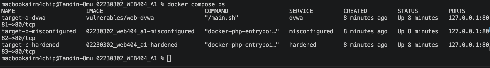
*Figure 1: `docker compose ps` shows the three containers running on `127.0.0.1:8081` to `8083`.*

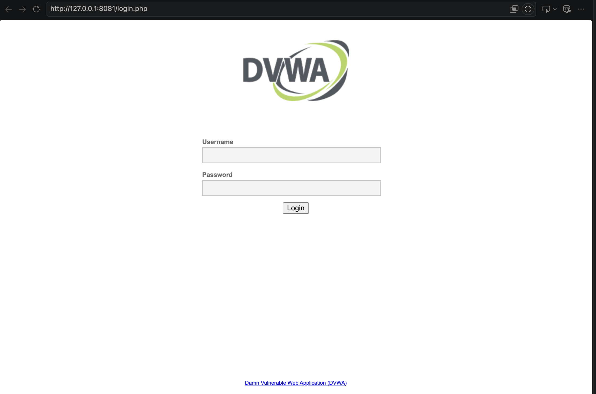
*Figure 2: Target A (DVWA) login page.*

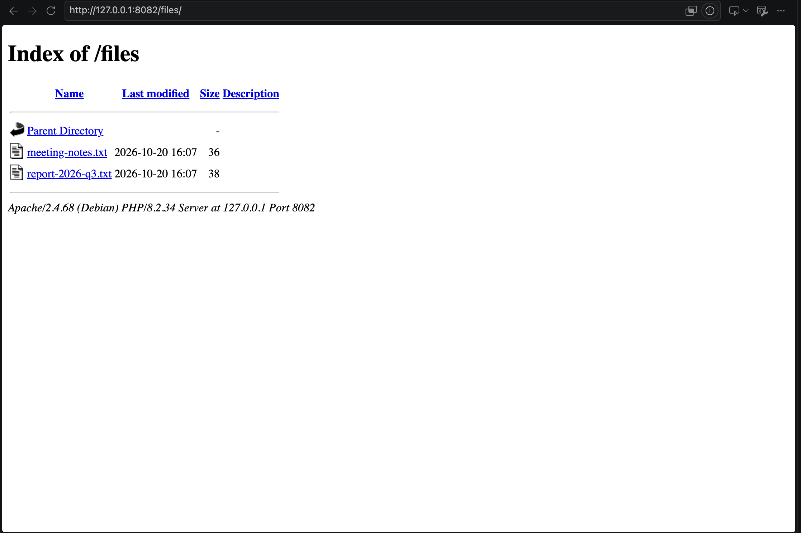
*Figure 3: Target B already shows a directory listing and the full Apache/PHP version.*

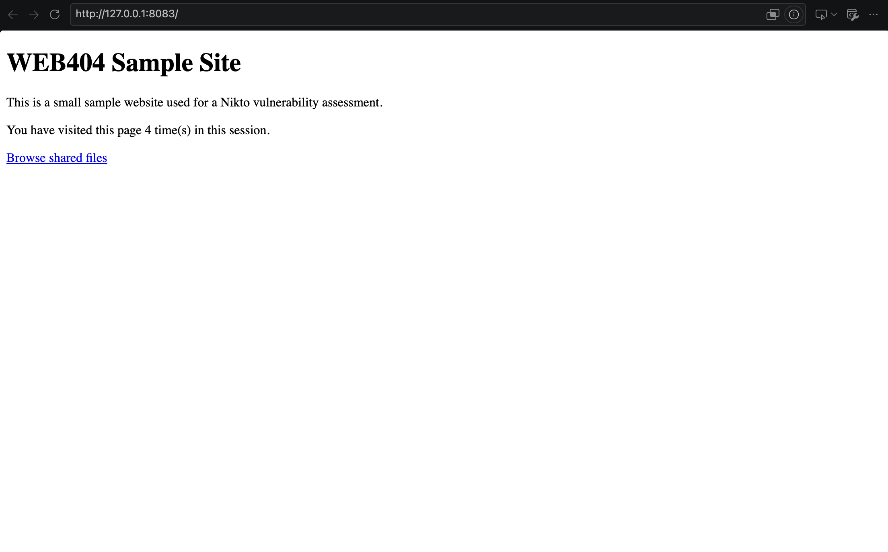
*Figure 4: Target C looks the same as B; the differences are in headers and settings.*

**How B and C differ:**

- **B (misconfigured):** `ServerTokens Full`, `ServerSignature On`, `expose_php = On`, `Options Indexes`, `TraceEnable On`, `display_errors = On`, no cookie flags, no security headers, plus leftover files (`phpinfo.php`, `test.php`, `index.php.bak`, `backup/config.php.bak`).
- **C (hardened):** the opposite of each setting, cookie flags `HttpOnly`, `Secure` and `SameSite=Strict`, four security headers, and no leftover files. The exact settings are shown in Section 7.

---

## 4. Methodology

`scan.sh` runs seven scans: a basic scan of each target, a `-Tuning 123b` scan of each target, and a `-Tuning 49` scan of DVWA. Every scan uses this command:

```bash
nikto -h 127.0.0.1 -p <port> -ask no -nointeractive \
      -o results/<target>_<scan>.htm -Format htm [-Tuning ...] | tee results/<target>_<scan>.txt
```

**What this does:** scans one local target and saves the result as HTML and text.

`-ask no` stops Nikto from asking to send data to its developers, and `-nointeractive` stops it waiting for key presses. `-Tuning` runs only some groups of tests, which makes the scan faster and quieter.

```bash
nikto -h 127.0.0.1 -p 8082 -ask no -Tuning 123b
```

**What this does:** runs only the config tests (interesting files, misconfiguration, info disclosure, software ID).

```bash
nikto -h 127.0.0.1 -p 8081 -ask no -Tuning 49
```

**What this does:** runs only the XSS and SQL injection tests against DVWA.

On B, the tuned scan found the **same 19 items with 47% fewer requests** (4,214 vs 7,969). The basic scans reported 16 items on DVWA and 3 on C. The injection scan on DVWA (1,020 requests, 8 items) found **no** SQL injection or XSS.

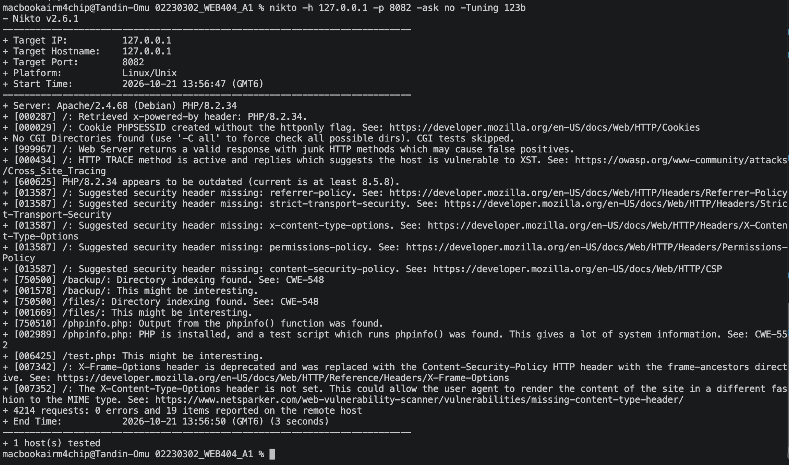
*Figure 5: `-Tuning 123b` scan of Target B: 4,214 requests, 19 items, 3 seconds.*

---

## 5. Findings

Nikto does not rate risk, so the ratings below are an independent judgement after manual checks, with the OWASP Top 10:2021 category in brackets.

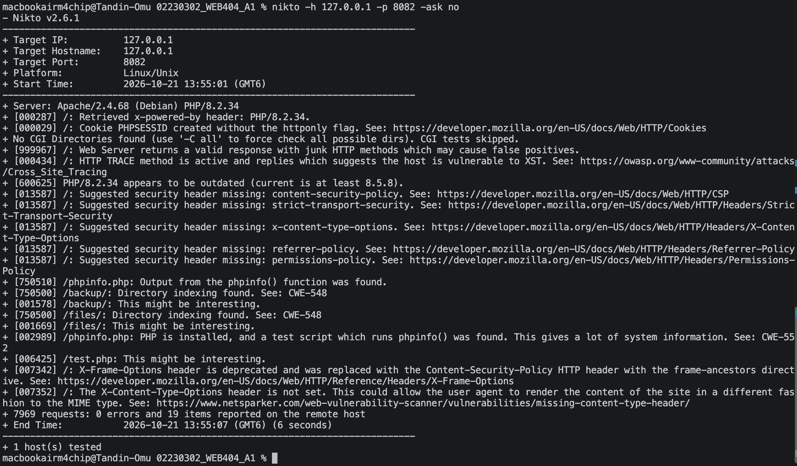
*Figure 6: Basic scan of Target B: full versions, TRACE, `phpinfo.php`, `/backup/`, `/files/`, `/test.php`; 7,969 requests, 19 items.*

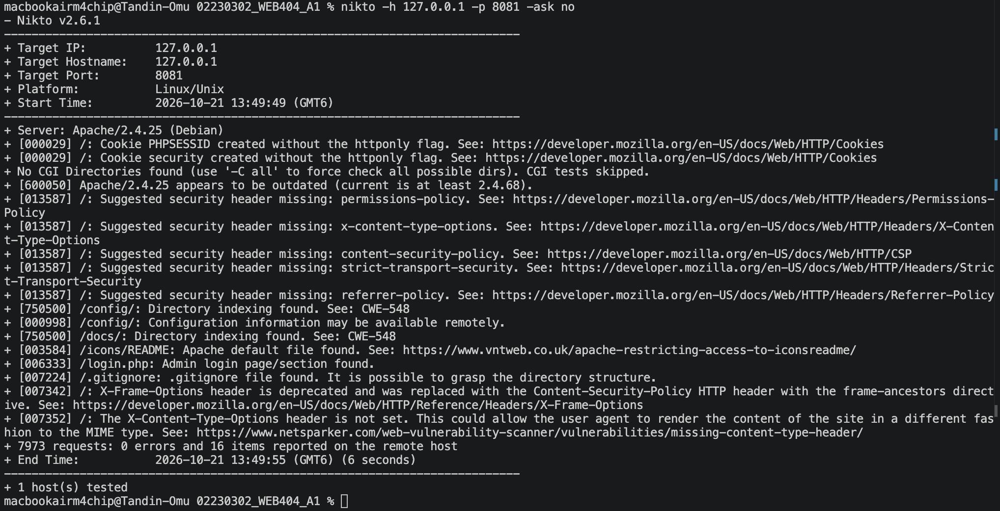
*Figure 7: Basic scan of DVWA: outdated Apache 2.4.25, cookies without `httponly`, `/config/` and `/docs/` listings, `/.gitignore`; 16 items.*

| Finding | What it means | Risk | Fix |
|---|---|---|---|
| B: `/backup/` listing with `config.php.bak` | Anyone can download it and read the DB password | **High** (A05) | No backups in web root; `Options -Indexes` |
| B: `/phpinfo.php` | Leaks PHP version, modules, paths and OS | **Medium** (A05) | Delete debug pages |
| B: `/files/` listing | Internal files can be browsed and downloaded | **Medium** (A01) | `Options -Indexes` |
| B: `PHPSESSID` without `HttpOnly` | XSS can steal the session | **Medium** (A07) | `HttpOnly`, `Secure`, `SameSite` |
| B: TRACE enabled | Can help Cross Site Tracing | **Low** (A05) | `TraceEnable Off` |
| B: Full versions in `Server` / `X-Powered-By` | Helps attackers find known bugs | **Low** (A05) | `ServerTokens Prod`, `ServerSignature Off`, `expose_php = Off` |
| B: Missing CSP, X-Frame-Options, X-Content-Type-Options, Referrer-Policy | Less browser protection against XSS, clickjacking, MIME sniffing | **Low** (A05) | Add headers with `mod_headers` |
| B: `/test.php` | Leftover development file | **Low** (A05) | Remove before deploying |
| A: `/config/` listing | Config file shows DB user `root` and its password | **High** (A05) | Disable listing; move config out of web root |
| A: Apache/2.4.25 outdated | Old version with publicly known bugs | **High** (A06) | Update Apache |
| A: `PHPSESSID` and `security` cookies without `HttpOnly` | Session theft via XSS | **Medium** (A07) | Set cookie flags |
| A: `/docs/` listing, `/.gitignore`, `/icons/README` | Leak file names and project structure | **Low** (A05) | Remove or block; `-Indexes` |
| A: `/login.php` found | Target for password guessing | Info (A07) | Rate limiting, lockout, strong passwords |
| A: SQLi, XSS, command injection (**missed by Nikto**) | DVWA's real flaws | **High** (A03) | Test with ZAP or Burp; fix the code |

Nikto also reported missing Permissions-Policy, missing HSTS and "PHP/8.2.34 outdated" on B. These are only informational (Section 6 explains why).

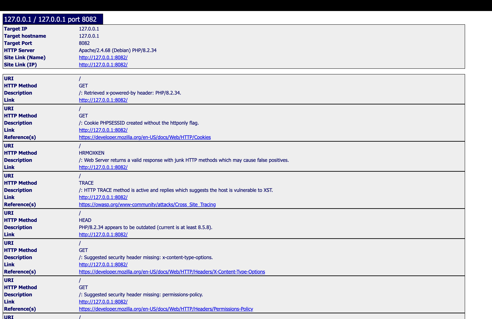
*Figure 8: `results/misconfigured_basic.htm` in a browser. Each box is one finding with its URL, HTTP method and description.*

---

## 6. Manual verification and false positives

```bash
./verify.sh | tee results/manual-verification.txt
```

**What this does:** runs `curl` checks against all three targets and saves the evidence.

```bash
curl -sI http://127.0.0.1:8082/
```

**What this does:** shows only the response headers.

B sends `Server: Apache/2.4.68 (Debian) PHP/8.2.34`, `X-Powered-By: PHP/8.2.34` and a cookie with no flags. C sends only `Server: Apache`, no `X-Powered-By`, a `secure; HttpOnly; SameSite=Strict` cookie and all four security headers.

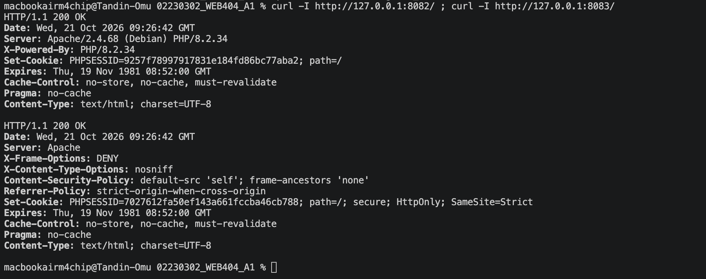
*Figure 9: Response headers from B (top) and C (bottom).*

```bash
curl -s -o /dev/null -w "%{http_code}" http://127.0.0.1:8082/files/
```

**What this does:** prints only the status code (200 exposed, 403 forbidden, 404 missing).

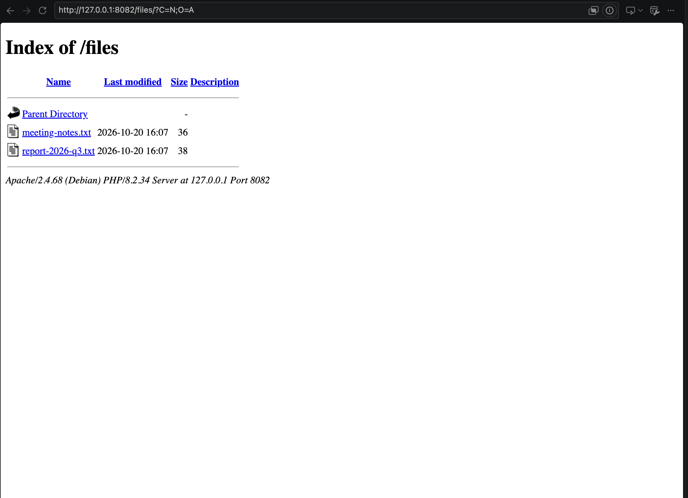
*Figure 10: "Index of /files" on B; both files can be downloaded and the footer leaks the version.*

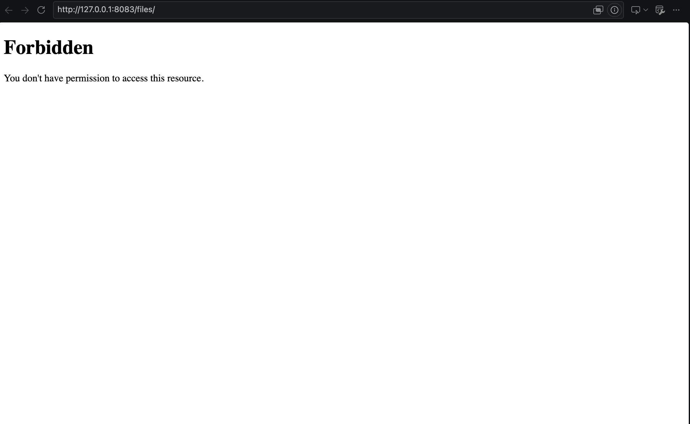
*Figure 11: The same folder on C returns "Forbidden" with no version shown.*

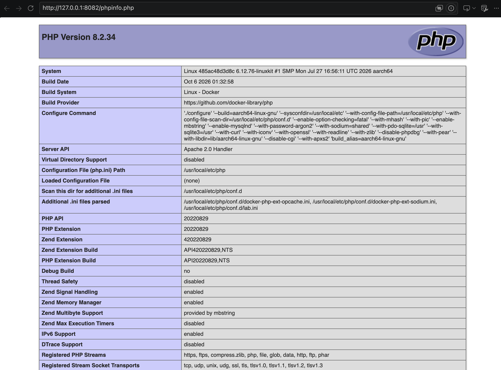
*Figure 12: `phpinfo.php` on B reveals PHP 8.2.34, the kernel, CPU type and config paths.*

What the manual checks showed:

- **Missed `.bak` files (false negative):** Nikto reported `/backup/` but not the file inside it, and never found `index.php.bak`. Fetching `/backup/config.php.bak` returns raw source with `$db_user = 'webapp'` and `$db_pass = 'Password123!'`. This is the most serious issue on B.
- **DVWA config was worse than reported:** Nikto only said config information "may be available". `curl -s http://127.0.0.1:8081/config/config.inc.php.dist | grep "db_"` shows `db_user = 'root'` and `db_password = 'p@ssw0rd'` in plain text.
- **Junk HTTP methods (false positive):** `curl -X FOOBAR` returned 200 on both B and C, because Apache just ignores the unknown method and serves the normal page.
- **HSTS missing (not applicable):** the lab uses plain HTTP, and browsers ignore HSTS over HTTP.
- **PHP "outdated" (informational):** Nikto compares against the newest branch (8.5.8); an older supported branch is not a vulnerability by itself.
- **Misleading and duplicate messages:** Nikto called X-Frame-Options "deprecated" when it was actually missing, and reported X-Content-Type-Options twice.
- **Other misses:** missing `Secure` and `SameSite` cookie flags on B, and all of DVWA's injection and CSRF flaws, even with `-Tuning 49`.

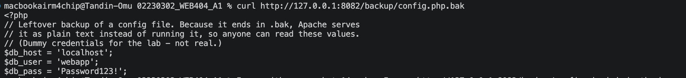
*Figure 13: The raw backup file shows the database username and password (lab dummy values).*

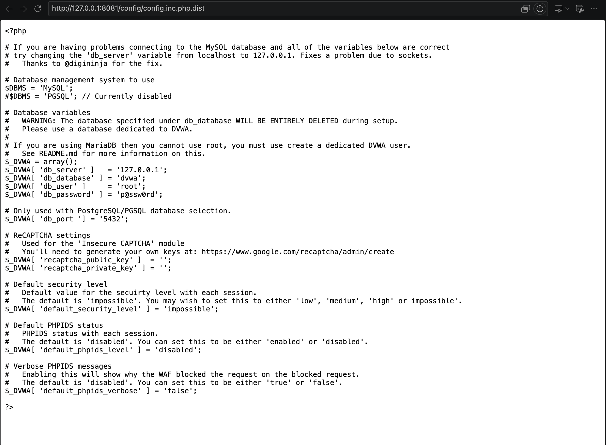
*Figure 14: DVWA's `config.inc.php.dist` readable as plain text in the browser.*

---

## 7. Before vs after hardening

Target C runs the same website as B. The only differences are a few settings in two files, and leftover files are not copied in. Each setting fixes one problem from B.

**Apache settings** (`target-c-hardened/security.conf`):

- `ServerTokens Prod`: the server says only "Apache", with no version number.
- `ServerSignature Off`: error pages no longer show the server version.
- `TraceEnable Off`: blocks the TRACE method.
- `Options -Indexes`: turns off directory listing, so folders like `/files/` cannot be browsed.
- Four security headers tell the browser to protect the page:
  - `X-Frame-Options "DENY"` stops other sites from putting the page in a frame (clickjacking).
  - `X-Content-Type-Options "nosniff"` stops the browser from guessing file types.
  - `Content-Security-Policy "default-src 'self'"` only allows scripts, styles and images from this site.
  - `Referrer-Policy` stops full URLs from being sent to other sites.

**PHP settings** (`target-c-hardened/php.ini`):

- `expose_php = Off`: removes the `X-Powered-By` header that showed the PHP version.
- `display_errors = Off` and `log_errors = On`: errors go to a log file instead of the visitor's screen.
- Three session cookie flags:
  - `HttpOnly` means JavaScript cannot read the cookie.
  - `Secure` means the browser only sends it over HTTPS.
  - `SameSite=Strict` means the browser does not send it on requests from other sites.

**Result:** findings dropped from **19 to 3** (an 84% reduction). On C, TRACE returns 405, `/files/` returns 403, and `/backup/`, `/phpinfo.php`, `/test.php` and both `.bak` files return 404. The 404 page no longer shows the server version.

The 3 items left on C are the junk methods false positive, HSTS (not applicable on HTTP) and a missing Permissions-Policy (informational; one more `Header always set Permissions-Policy` line would remove it). The website code did not change; only configuration did.

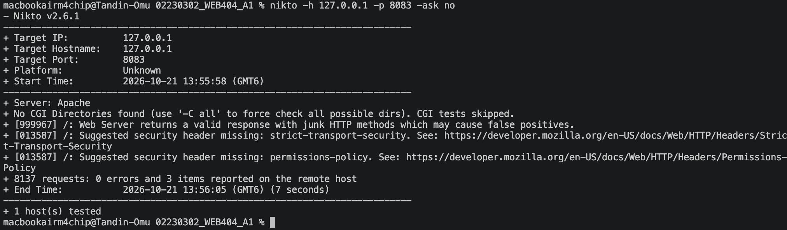
*Figure 15: Basic scan of the hardened site: `Server: Apache` with no version, 8,137 requests, only 3 items.*

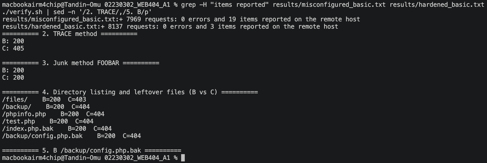
*Figure 16: Nikto summary lines for B (19 items) and C (3 items), with `verify.sh` status codes for both sites.*

---

## 8. Conclusion

Nikto quickly found most server misconfigurations and outdated software, and tuning made it faster without losing results. But it missed the most serious leak (the `.bak` password file) and every DVWA injection flaw, so its results must be checked by hand and backed up with a tool like Burp Suite or ZAP. Simple configuration changes removed every real risk on Target B. Scanning must only be done on systems you own or have permission to test.

---

## 9. References

- Nikto: https://github.com/sullo/nikto
- OWASP Top 10:2021: https://owasp.org/Top10/
- OWASP Secure Headers Project: https://owasp.org/www-project-secure-headers/
- OWASP Cross Site Tracing: https://owasp.org/www-community/attacks/Cross_Site_Tracing
- CWE-548 (Directory Listing): https://cwe.mitre.org/data/definitions/548.html
- CWE-552 (Files Accessible to External Parties): https://cwe.mitre.org/data/definitions/552.html
- Apache HTTP Server 2.4 documentation: https://httpd.apache.org/docs/2.4/
- PHP runtime and session configuration: https://www.php.net/manual/en/session.configuration.php
- MDN, Set-Cookie: https://developer.mozilla.org/en-US/docs/Web/HTTP/Headers/Set-Cookie
- DVWA: https://github.com/digininja/DVWA
- OWASP ZAP: https://www.zaproxy.org/
- Burp Suite: https://portswigger.net/burp
